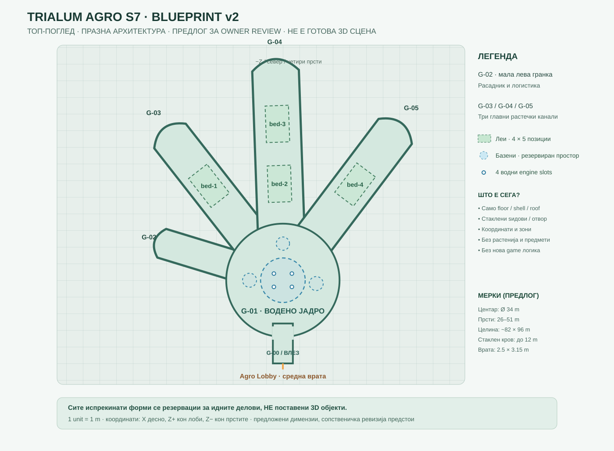

> **HISTORICAL v2 — SUPERSEDED by owner correction V3 (17 Nov 2026):** Do NOT build a nursery in G-02 or use bed allocation 1+2+1. **All four fingers G-02/03/04/05 have one original terrestrial bed each** (bed-1/2/3/4), while nursery + computer + **smaller seedling racks RS** + **larger and more numerous mature racks RM** move to **G-00L, LEFT immediately upon entering**, inside the existing main shell. See [Owner V3](S7_GREENHOUSE_OWNER_LAYOUT_CORRECTION_V3_20261117.md), [updated spatial JSON](blueprints/LW_D_AGRO_S7_GREENHOUSE_BLUEPRINT_V3_LAYOUT_20261117.json), [master roadmap](S7_GREENHOUSE_EXECUTION_ROADMAP_20261117.md). Keep this old v2 file only for architectural history; current game G01 already has actual water (PR88).

# TRIALUM LW-D S7 — BIO-PAW GREENHOUSE
## BLUEPRINT v2 · Празна архитектонска школка · топ-поглед · сценарио · интеграциски граници
**Датум:** 16.11.2026 · **Status:** PROPOSAL FOR OWNER REVIEW · **Не е GLB / не е APK / не е OWNER PASS**

**Видлив и мерлив план:** [Blueprint v2 top view · SVG](blueprints/LW_D_AGRO_S7_GREENHOUSE_BLUEPRINT_V2_TOP_VIEW_20261116.svg)  
**Машински координати:** [Blueprint v2 spatial layout · JSON](blueprints/LW_D_AGRO_S7_GREENHOUSE_BLUEPRINT_V2_SPATIAL_LAYOUT_20261116.json)  
**Претходна сопственичка визија:** [Blueprint v1](LW_D_AGRO_S7_GREENHOUSE_BLUEPRINT_V1_20261116.md)  
**Следно чатче:** [CONTINUE_HERE](LW_D_AGRO_S7_CONTINUE_HERE_20261116.md)

## 0. Точно што правиме СЕГА

**Одлуката на сопственикот ја ажурира претходната производствена секвенца:**
1. **СЕГА:** комплетен архитектонски Blueprint v2, во контекст на главното Agro Lobby, S6 Food Warehouse, растителниот L3.9 engine и идниот PhytoLab.
2. **ПРВА ВИСТИНСКА ГРАДБА, дури по сопственичка ревизија:** целосна **празна надворешна школка** — footprint во форма на шепа, стаклени ѕидови, носечки ребра, кров, спојна врата. **Не поставувај предмети.**
3. **ВТОРА ВИСТИНСКА ГРАДБА:** целосна **празна внатрешна школка**, единствена непрекината површина за движење, базни архитектонски разграничувања, camera и back од лоби, **само програмски/визуелни маркери за идните зони**. Нема базени, леа, вода, земја, расад, робот, ограда, машина, светилка, HUD терминал или статичен проп како предмет.
4. **ПОТОА (строго дел по дел):** визуелен рендер/одобрување на **еден** дел или семејство предмети → вистински .glb за тој дел → визуелно/техничко усогласување со Blueprint v1/v2 и сценариото → тест/составување на тој дел → анимација по потреба → owner review → следен дел.
5. **НА КРАЈ:** кога сите делови се целосно изработени и визуелно/функционално согласни, поврзи **еден по еден** систем со оригиналниот engine, канонскиот game clock и постојните save ID; не пишувај нови механики во празната школка. Потоа завршно визуелно/осветлувачко/перформанс-полирање, QA, owner PASS, па B8 PhytoLab и B9 целосно Agro крило.

Ништо од фазите 2–5 не е сторено со овој docs-only Blueprint. SVG и JSON се **нацрт/метаподатоци**, не рендерирани сцени или geometry assets.

## 1. Концепт: архитектурата како дел од сценариото

Стакленикот е вистинска доградба на приземјето, достапна само преку **средната врата на Agro Atrium**. Однадвор е огромна шепа на Trialum милениче:
- **Кружното перниче G-01** е воденото јадро — еден главен и неколку помали идни базени, обиколни патеки и сервисна инфраструктура.
- **Најмалата ЛЕВА гранка G-02** е **двонаменскиот расадник/складиште** за новосоздадени садници и зрели примероци спремни за пренос, со контрола и логистика.
- **Трите подолги прсти G-03, G-04, G-05** се стаклени растителни канали. Одозгора се читливи како прсти, внатре има доволно висина и простор за сите постојни видови, различна фаза, раст, нега и роботски транспорт.
- **Влезот G-00** е тесниот конектор од постојното стаклено/ботаничко лоби; не е петта гранка на шепата.

Играчот е **управувач на автономен жив систем**. Фабриката на фито-адитиви не е во оваа градина; таа останува посебниот иден PhytoLab. Производството на **храна** останува во веќе прифатениот Food Lab → Warehouse → per-pet reserve flow. Нема мешање на храна, садници, адитиви и token валута.

## 2. Поврзување со вистинското постојно лоби — проверена основа

Реални постојни изворни вредности од `prototypes/lw-d/scenes/agro-lobby/scene.json` и `visual-recipe.json`:
- `sceneId: trialum.ground.agro.lobby`, `buildingId: trialum.agro`, `floorId: ground`.
- Лобито е **14 m широко × 18 m длабоко × 6.2 m високо**.
- Портал **`ground.agro.lobby.door-garden`**: `[x=0, y=1.55, z=-8.32]`, `futureSceneId=trialum.ground.agro.garden`, **статус во старото scene.json: planned/inspect-only**, не претставувај го како веќе функционален премин.
- Двете соседни врати се x=-4.15 Warehouse и x=+4.15 PhytoLab. Не менувај ги нивните anchor IDs/сцени.
- Изворната предложена физичка ширина на врата е **2.5 m**, висина **3.15 m**.
- Физичкиот Food Warehouse има независна веќе постојна scene и back-премин. Не го ремапирај.

### Локален координатен договор — предлог за v2

Нова локална **градинска** сцена:
- `sceneId` (зачувана идентитетска дестинација): `trialum.ground.agro.garden`.
- Почеток `(0,0,0)`: центар на кружното перниче, на подот.
- **Y+ нагоре**, X+ десно, **Z+ кон Agro Lobby**, Z− кон четирите прсти.
- Градинска врата `ground.agro.greenhouse.door-main`: **локално `(0,1.55,+24)`**.
- Предложена ориентација без ротација во однос на лобито.
- Предложено **поместување на garden-origin во lobby coordinates = `(0,0,-32.32)`**; затоа локалната garden-врата (+24) се совпаѓа со вистинската lobby-врата (-8.32).
- Ова е **архитектонска привремена физичка поставеност**, не доказ дека други простории нема да пресекуваат; провери ја при 3D shell building пред да се приклучи портал. Доколку има колизии, поместувај го целиот greenhouse со едно контролирано transform mapping, без да ги менуваш source door ID/return правила.

**Барање за навигација:** од лобито влегување во **празниот shell**, назад пак во **истото лоби**, со Android Back/врата и паузирање на renderer. Првокатното петвратно лабораториско лоби останува недопрено. Не користи standalone Greenhouse мени или паралелен HUD.

## 3. Димензионален план — ПРЕДЛОГ, не одобрени мерки

| Сектор | Предложена геометрија | Придонес кон физичката шепа |
|---|---|---|
| **G-01 централен pad** | Кружен под со **R=17 m / Ø34 m**, крив стаклен кров до ~12 m | Едно јасно кружно перниче |
| **G-00 влезно грло** | Внатрешен прооден коридор ~**6 m широк**, од локално Z≈+13 до +25, со врата широка 2.5 m | Краток спој со главната зграда; не е „прст“ |
| **G-02 мал лев прст** | Насока **−73° од север (−Z)**, r=12→38 m, ширина 9 m, кров ~7.5 m | Лева најмала гранка/расадник |
| **G-03 голем лев прст** | Насока **−38°**, r=12→55 m, ширина 12 m, кров ~9 m | Првиот копнен канал |
| **G-04 голем среден прст** | Насока **−2°**, r=12→63 m, ширина 14 m, кров ~10 m | Најдолгиот и најширок канал |
| **G-05 голем десен прст** | Насока **+37°**, r=12→56 m, ширина 12.5 m, кров ~9 m | Третиот копнен канал |

**Приближна надворешна envelope:** ~82 m ширина × ~96 m должина, со стаклен кров до ~12 m. Шепата е огромна во однос на 14×18 m Atrium; затоа се предвидува **streaming по зони**, modular GLB, LOD, постепено вчитување, граници на светло/сенки и idle dispose, наместо одеднаш да се прикажат милиони полигони на Galaxy A55.

### Техничко правило за shell

Четирите прсти нацртани како rounded corridor volumes влегуваат ~5 m во централниот pad. Реалниот shell-builder мора да направи **еден union на подот/обвивката** и да не остави тврди „ѕидови“ на премините. SVG може да ги прикажува преклопените контури, но **не смее** да се толкува како дозвола за слепи внатрешни ѕидови на секој влез во гранките.

### Димензии за човечка/мобилна проодност

- На G-00 главниот премин има најмалку ~3 m чиста предвидена траса, дури и ако потоа се додаде декорација.
- Во секој прст задржи најмалку ~2.5–3 m континуирана централна безбедна рута, со сервисни заобиколувања и камерен простор.
- Нема огради сега; резервираните контури на идните базени и леи **не се физички colliders** во празниот shell.
- Кога ќе се моделираат предмети, нивните колизии никогаш не смеат да го блокираат Back, доближување до растенијата и пристап до сите три коридори.

## 4. Што е резервирано — САМО ознаки, не физички предмети

Топ-погледот содржи испрекинати контури **за планирање**. Овие метаподатоци не создаваат geometry, вода, инвентар или анимации.

| Reservation | Локација (garden X,Z) | Идна намена | Реален engine лимит |
|---|---|---|---|
| `pool-main` | (0,0), R≈6.7 m | Голем централен базен со водни растенија | 4 водни позиции **вкупно**, не по базен |
| `pool-satellite-1` | (−10,0), R≈2.1 m | Мал базен/сервисна вода | Нема дополнителни slots |
| `pool-satellite-2` | (+10,+1), R≈2.1 m | Мал базен/сервисна вода | Нема дополнителни slots |
| `pool-satellite-3` | (0,−11), R≈2 m | Мал базен/сервисна вода | Нема дополнителни slots |
| `aquatic-slot-1..4` | (−2.7,−2), (+2.7,−2), (−2.7,+2), (+2.7,+2) | 4 конкретни водни plant anchors во главниот базен | **4** |
| `bed-1` | G-03, на r≈36 m | 1 земјена леа | 5 slots |
| `bed-2` | G-04, на r≈29 m | 2. леа | 5 slots |
| `bed-3` | G-04, на r≈47 m | 3. леа | 5 slots |
| `bed-4` | G-05, на r≈36 m | 4. леа | 5 slots |
| `nursery-incoming` | G-02, на r≈20 m | Прием на расади | Чита `s.agro.seedlings` |
| `nursery-mature` | G-02, на r≈28 m | Складирање зрел примерок | Ист `plantId`, не клон |
| `nursery-control` | G-02, на r≈35 m | Дисплеи/логистика | Без engine writes од child |

**Предложена распределба 1+2+1** на четирите копнени леи низ трите големи прсти е компактна и ги зачувува сите постојни 20 места. Не заклучувај ги гранките строго по возраст; секоја може да содржи вид и фаза според вистинските L3.9 податоци. За големи/необични флора модели дополнителниот **визуелен простор** не е автоматски нов slot.

### Патеки/идни сервисни зони

- Еден пристап од G-00, кружно движење околу water-core, растерувачки влезови во четирите гранки.
- Резервирај обиколна патека околу главниот базен и рути за роботски транспорт, но **не моделирај патеки со огради во празниот shell**.
- G-02 има резервиран влезен прием, зрела станица и контролен пункт; истите простори ќе се пополнуваат **по одобрен рендер и GLB**, не сега.
- Во G-01 планирај одделна водна сервисна зона (пумпа, филтер, цистерна), но таа не е реален engine систем во B6.

## 5. Сценарио / engine / UX усогласување

### Веќе постоечки факти
- L3.9 engine има вистински `s.agro.seedlings`, `s.agro.gardenPlants`, plant IDs, life-cycle/death, и пресадување во `h.flora[]`.
- Капацитетот е 4 леи со по 5 места и 4 водни места. Не се менува со геометрија.
- На садење, растење, венење, зреење и пресадување им владее **единствен оригинален engine**, не Three.js child.
- S6 Food Lab/warehouse/reserves е одобрена и не се менува од garden сценографија.
- Постојната Flora Laboratory создава blueprint/растителен модел; расадникот управува со реално произведени расади, а не создава бесплатни примероци од рендер.

### Нова сопственичка намера за B7+ (НЕ кодирај сега)
- Роботска автономија: системот сам ги распоредува садниците, одржува, пресадува/преместува и ги следи растенијата. Потврден единечен engine intent/receipt пред секоја реална промена.
- Индивидуално и групно здравје, можност за ширење болест на соседните растенија со разумни временски ограничувања.
- Автоматско наводнување со реални ресурси; корисникот контролира цистерни, почва, лабораториски ресурси и фито-адитиви. Водните растенија бараат вода-квалитет/замена/филтри, не копнено полевање.
- Мали трошоци во *постојните заработливи токени* само по одобрени цени; нема ин-ап плаќање, реклами или нов токен ledger.
- Нотификации со opt-in, cooldown и етички баланс; дневен надзор без компулсивни казни.
- Локален часовник за **сценско ден/ноќ**, без да го забрза/промени канонскиот симулациски game-clock; сезоните се само future provision.

### Архитектонски предуслови од денес
Маркери за plant IDs, water quality, service alerts и роботи се **симболички мапирани**. Не ги поставувај во празната сцена; engine-синхронизацијата и анимациите доаѓаат поодделно кога ќе има предмети и одобрен UI.

## 6. Практичен сценски состав — shell прво, па секој модул одделно

| Микро-фаза | Што навистина се прави | Што уште НЕ смее |
|---|---|---|
| **S7.0** (сега) | Blueprint v2, editable SVG, JSON coordinates, handoff; owner review | GLB, runtime scene, game writes |
| **S7.1** | ПРАЗНА **надворешна школка**: footprint со 4 стаклени прсти и централен pad, архитектонски ребра, ѕидови/кров и врска со лоби | предмети, ефекти, леи/вода, машини |
| **S7.2** | ПРАЗНА **внатрешна школка**: непрекинат под, четири отворени коридори, camera/walkable/portal, marker IDs only | леи/вода, огради, растенија, deco пропови |
| **S7.3** | Render/approval → GLB → placement само за **G-01 water-core архитектонски дел** | не започнувај G-02 пред G-01 QA |
| **S7.4** | Render/GLB/QA за **G-02 расадник и логистика** | нема fake production |
| **S7.5** | Render/GLB/QA за **G-03** (4×5 mapping зачуван) | нема паралелен growth engine |
| **S7.6** | Render/GLB/QA за **G-04** | нема двојна копнена леа |
| **S7.7** | Render/GLB/QA за **G-05** | нема неиздржано auto-transplant |
| **S7.8** | Поединечни детали/роботи/анимации/звук/ноќно осветлување; едно по едно | без nonstop GPU/background симулација |
| **B7** | Вистински состојби на поединечно растение/група, оригинални engine bridge intents, автономни job системи, alerts/token economy по одобрени правила | без нов engine на страната на renderer |
| **B8/B9** | PhytoLab → склопени три простории и лоби, ретро-лаб дури по целосен Agro OWNER PASS | без предвремен Play release |

**Рендер/GLB/Blueprint/shell конзистентност:** за секој модул има една „asset card“ во [Scene Asset Ledger](LW_D_AGRO_S7_SCENE_ASSET_LEDGER_20261116.md): ID, master reference, сцена, сопственички визуелен verdict, GLB path, anchor names, collision, анимации, tests, performance и rollout. Следниот модул се почнува само после реална проверка на претходниот.

## 7. Празна сцена: техничка приемна матрица

**S7.1 надворешност** (откако ќе биде изградена):
- Силуета одозгора: точно 1 централен pad + 4 прсти, најмалата гранка лево и 3 подолги/пошироки.
- Спој со лобито на постојната **средна** врата, без да се оштети соседниот Food Warehouse/PhytoLab anchor.
- Стаклен покрив и носачи се стварни GLB meshes; не се single PNG/flat scene.
- Real GLB loader + anchors: без missing-anchor fallback, без бел/црн frame на Android.
- Од надвор во камерата се гледа „празна градина“; не се прикажуваат невидени објекти како готови.

**S7.2 внатрешност**:
- Прооден под со непрекинати четири branches, без внатрешни walls на overlap.
- Клик/Back/exit, бавно и брзо ротирање камера, touch scroll/pinch и прекини со враќање во лоби.
- Зони визуелно ознакени само во **debug/planning** режим; реален HUD без лажен stock/plant count.
- На Galaxy A55 Eco/Balanced/High: 30+ транзиции, FPS/рамка/термално прифатливо според owner-преглед, нулти black frames, screen safe insets.
- Game/save/backup и прифатен S6 flow **бит-за-бит недопрени**.
- QA без mode-to-mode GL resource leaks, renderer активен само кога е видлив.
- Само успех на автоматските тестови не заменува физички OWNER PASS.

## 8. Контрола на неусогласености / одлуки

| Тема | Усогласување |
|---|---|
| Три градинарски прсти vs 4 engine леи | **1+2+1 предложено**, 4×5 зачувано |
| Голем + повеќе мали базени vs 4 водни позиции | **само 4 водни engine slots**, додатните базени декоративни/сервисни |
| Мал прст складира и никулци и зрели | две одвоени **идни** подзони со исти оригинални plant IDs |
| Расадник и веќе постојна лабораторија за флора | Flora Lab отклучува/истражува; greenhouse physically расте/складира |
| Garden vs Food Warehouse | различни original-state domains; S6 stock недопрен |
| Автоматски роботи vs старо рачно садење | B7 спецификација на scheduler + original engine gate, **не измама во B6** |
| Болести vs постојно plant health/death | болести меѓу соседни = **нова** одлука; existing health/death останува |
| Локално ден/ноќ vs game days | local clock само светло/амбиент, не health clock |
| Празна просторија vs „планирани базени/леи“ | dashed SVG ознаки и JSON metadata, **без предмети/GLB/game state** |
| High quality vs A55 performance | модуларен GLB, LOD, streaming, real-device QA |
| Врска со лоби vs независни локални сцени | исти route ID и експлицитен transform, no auto-wiring пред тест |

## 9. Owner review: што бараме да оцени

За прифаќање/измена на **Blueprint v2**, сопственикот гледа: (а) дали шепата ја има вистинската форма, (б) дали е доволно монументална, (в) дали централниот круг и водната логика се функционални, (г) дали малата лева гранка е доволно пространа за расадник/зрели/контрола, (д) дали трите големи прсти имаат простор за 1+2+1 леи и големи растенија, (ѓ) дали влезот е природен продолжеток на Atrium.

**Овој Blueprint v2 е направен како предлог за ревизија. Не е издадено S7 owner approval, не се креирани S7 .glb/3D objects и не се чепнати game/save/Play.**

## 10. Следен оперативен handoff

Тековна гранка: `feature/lw-d-agro-s7-greenhouse-blueprint-20261116`, [Draft PR #84](https://github.com/extreme4music-nexus/Trialum/pull/84). Читај `docs/LW_D_AGRO_S7_CONTINUE_HERE_20261116.md` и `docs/LW_D_AGRO_S7_ENGINE_CONTRACT_AND_OPEN_DECISIONS_20261116.md` пред следен commit.

**Единствена непосредна наредба:** покажи го Blueprint v2 за owner review. По owner-одобрување, изгради прво **само празна надворешна и внатрешна shell**, потоа рендер и вистински GLB за **еден по еден** одобрен сегмент. Без избрзана глобална сценографија или B7 пред реален shell.
